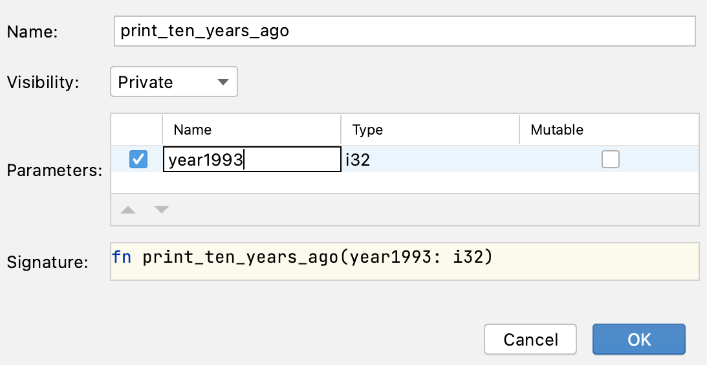

## 掌握IDE：提取方法重构

开发人员被要求更改在本任务中看到的代码的消息格式。

我们想要打印 "1993: 十年前是1983" ，而不是 "1993: 10年前是1983"。

然而按现在的实现方式，开发人员必须在两个地方修改消息，当这段代码用于更多地方时，将会变得更加不方便。

所以在实际更改消息格式之前，开发人员决定进行重构并创建一个打印消息的函数。

### 任务

**步骤1：创建一个函数**

进行重构并创建一个新函数以替换重复的代码。

选择第一次出现的

```rust
println!("{}: 10 years ago was {}", year1993, year1993 - 10);
```

然后按下&shortcut:ExtractMethod;或从右键菜单选择*Refactor -> Extract Method...*。

在出现的对话框中，你可以为参数选择一个更合适的名称（例如，year）：



**步骤2：替换重复的代码**

创建新函数后，用新的函数调用替换代码的第二次出现。

**步骤3：更改文本**

最后，在函数体中将 "10" 改为 "十"。