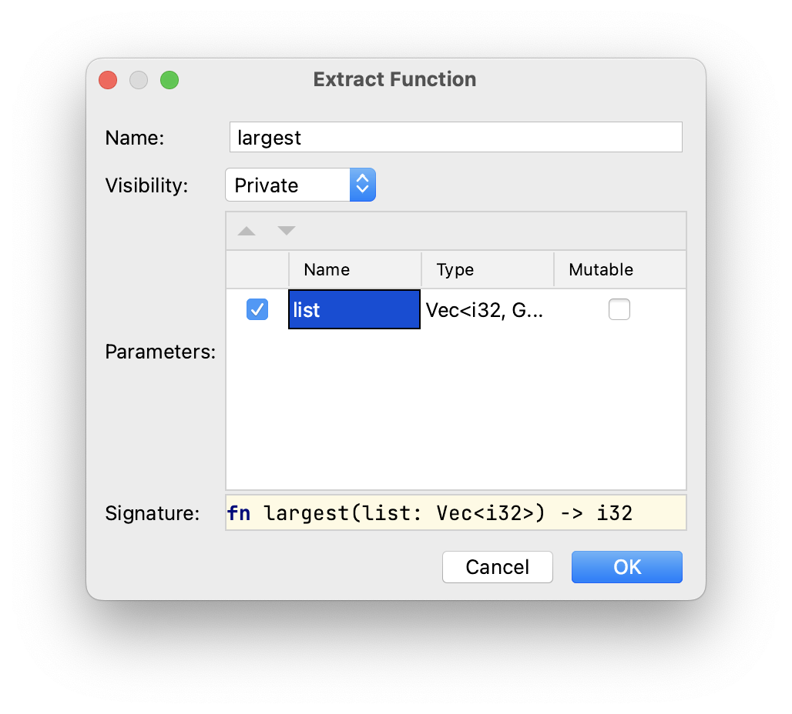

## 通过重构移除重复

为了消除这种重复，我们可以通过定义一个函数来创建一个抽象，该函数对任何传递给它的整数列表进行操作。该解决方案使我们的代码更清晰，并让我们以抽象的方式表达在列表中查找最大数字的概念。

我们可以使用%IDE_NAME%中的各种重构工具，通过几个步骤来实现这一目标。

### 第1步：提取函数

注意编辑器中从第4行开始的第一个框架。选择整个框架，然后按&shortcut:ExtractMethod; 或者从右键菜单中选择 *Refactor -> Extract Method...*。

将函数命名为`largest`，并将参数名更改为`list`，如下所示：



执行该命令后，整个片段将被替换为以下单行代码：

```rust
let largest = largest(number_list);
```

您还将在`main`函数下面看到提取出来的函数：

```rust
fn largest(list: Vec<i32>) -> i32 {
    let mut largest = list[0];

    for number in list {
        if number > largest {
            largest = number;
        }
    }
    largest
}
```

请注意，代码仍会进行编译并与之前具备相同结果。

### 第2步：重命名变量

为避免名称冲突，我们需要重命名几个变量：

- `largest`变量的第一次绑定（第4行）应重命名为`result`；
- `largest`变量的第二次绑定也应重命名为`result`。

为此，可以按&shortcut:RenameElement; 或者在指向相应变量后选择*Refactor -> Rename...*。如果您遇到问题，请参阅[介绍此重构操作的任务](course://Common Programming Concepts/Variables/Introduce Variable Refactoring)。

### 第3步：替换重复的代码片段

现在，您可以选择编辑器中的整个第四个框架并用另一个对`largest`函数的调用，即`largest(number_list);`进行替换。

此时，您可能还想移除第二个`result`绑定的`mut`修饰符。我们不再需要它。

### 第4步：调整类型

我们可能还希望使我们的参数更加通用。为此，让我们在函数定义中用对切片的引用`&[i32]`替换`Vec<i32>`。此更改引入了几个编译错误，可以通过在`fn largest`调用位置的`number_list`变量前添加`&`以及在函数定义内`for`循环头中的`number`变量前添加`&`来修复。

此更改将使我们能够将该相同函数用于向量、数组和任何`i32`切片。